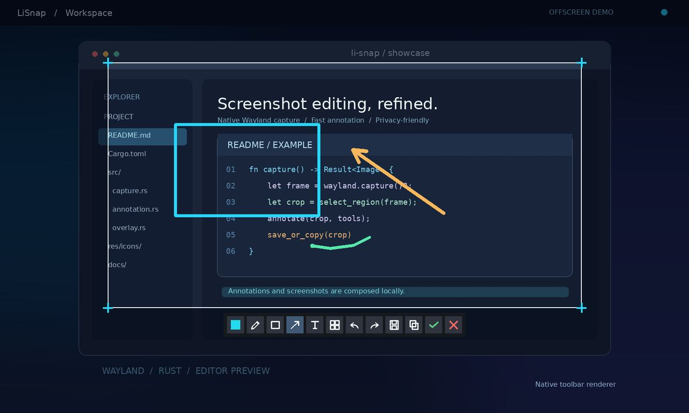
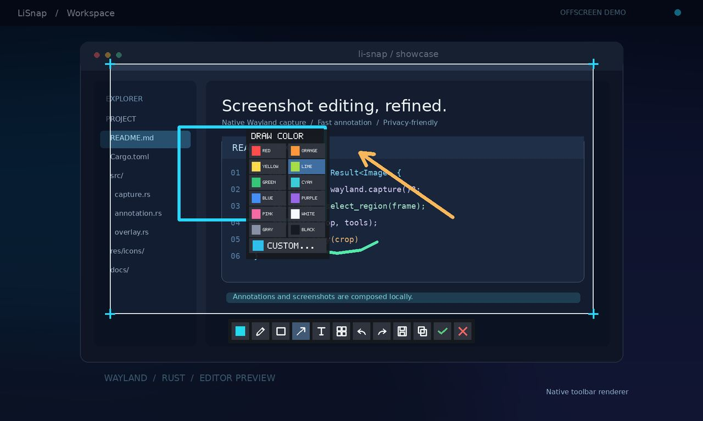

<!-- LiSnap | English -->
<p align="center">
  
</p>

<h1 align="center">LiSnap</h1>

<p align="center">
  <strong>A fast, native screenshot and annotation tool</strong><br />
  Built with Rust, focused on Linux / Wayland.
</p>

<p align="center">
  <a href="README.md">简体中文</a> · <strong>English</strong>
</p>

<p align="center">
  
  
  
  
</p>

LiSnap is a work-in-progress desktop screenshot editor with a straightforward workflow: **capture the screen → select a region → annotate → save a PNG or copy the image**. The interactive backend currently targets **Linux / Wayland**, preferring `ext-image-copy-capture` and falling back to `wlr-screencopy` when available, without a Screenshot Portal dependency. Native X11, Windows, and macOS backends are planned but **not yet implemented**.

## Interface previews

### Region selection and annotation



### Color palette



> **About these images:** The toolbar, annotations, and palette above were **rendered offscreen by LiSnap's existing Rust drawing code**, against a synthetic demo desktop. They are **not live Hyprland screenshots**. The automation environment cannot reach the host Wayland socket; real desktop screenshots and compositor validation remain pending. See [Capturing real screenshots](#capturing-real-screenshots).

## Highlights

- **Native Wayland capture:** Uses the active Hyprland monitor automatically, or an explicitly selected output via `--screen`. Opens a frozen frame with draggable region selection.
- **Live pixel dimensions:** Displays width × height (px) at the selection's top-left using actual capture pixels, including on scaled displays. The label is not included in saved or copied images.
- **Pixel magnifier and color inspection:** A 12× magnifier follows the pointer, highlights the center pixel, and shows its HEX / RGB color and pixel coordinates. Samples come from the original frozen capture, not the mask or annotations. Press `M` to show/hide it; it hides automatically during drawing, text entry, and tool menus, and is excluded from exported images.
- **Inline annotation:** Pen, rectangle, arrow, text, and mosaic, with selection/movement of existing annotations, draggable arrow endpoints, double-click text editing, and undo/redo.
- **Flexible drawing styles:** 12 preset colors, custom HSV selection, RGB/HEX input, plus configurable line width, font size, and mosaic block size.
- **Save or copy:** Save/Confirm writes an annotated PNG; Copy sends PNG data to the Wayland clipboard using `wl-copy` without creating an extra file.
- **Output feedback:** Successful Save/Copy immediately dismisses the capture UI and releases mouse/keyboard focus, leaving only an independent confirmation (including the saved path) for about 2 seconds. The toast does not intercept input, so other windows remain usable immediately. Failures show an error and keep the editor open so you can retry.
- **Cursor and text input:** Captured images exclude the pointer by default while the live pointer stays usable. Unicode text entry and Wayland `text-input-v3` integration are implemented, subject to compositor and IME support.

> **Alpha software:** Automated checks cover capture protocols, pixel processing, and editor logic. Multi-monitor scenarios, clipboard interoperability, and IME behavior still require verification in an actual Hyprland desktop session.

## Platform support

| Platform | Status | Notes |
| --- | --- | --- |
| Linux / Wayland | **Implemented; full desktop validation pending** | Requires a compositor exposing compatible capture and layer-shell protocols; primarily targeting Hyprland |
| Linux / X11 | Planned | Placeholder backend only |
| Windows | Planned | Native capture not yet implemented |
| macOS | Planned | Native capture not yet implemented |

## Quick start

**Requirements:** Rust / Cargo **1.97+**, a Linux Wayland session with the required capture protocols (`ext-image-copy-capture` or `wlr-screencopy`), and `wl-copy` from `wl-clipboard` for copying images. On Gentoo, install the clipboard dependency with:

```bash
emerge -av gui-apps/wl-clipboard
```

Clone, build, and start:

```bash
git clone https://github.com/MRsoymilk/LiSnap.git
cd LiSnap
cargo run -p lisnap
```

With no arguments, LiSnap **starts an interactive capture immediately** rather than opening a regular application window. Select a region, add annotations, then choose Save, Copy, Confirm, or Cancel from the bottom toolbar. Files are saved to `~/Pictures/LiSnap/` by default.

Useful commands:

```bash
# Interactive screenshot
cargo run -p lisnap

# Specify the PNG path
cargo run -p lisnap -- --output ~/Pictures/LiSnap/example.png

# Capture a specific monitor
cargo run -p lisnap -- --screen DP-1

# Open the standalone preferences window
cargo run -p lisnap -- --settings

# Override cursor inclusion for this capture only
cargo run -p lisnap -- --no-cursor
cargo run -p lisnap -- --include-cursor

# Inspect backends and Wayland protocols
cargo run -p lisnap -- --list-backends
cargo run -p lisnap -- --probe-wayland

# Open the development/diagnostic window
cargo run -p lisnap -- --window
```

For the complete CLI reference, run `cargo run -p lisnap -- --help`.

## Editor controls

| Action | How to use |
| --- | --- |
| Select a region | Drag with the left mouse button over the frozen screen |
| Resize selection | Drag any edge or one of eight handles after selecting; `Esc` cancels the resize, `Ctrl+Z` / `Ctrl+Y` undo/redo it. Existing annotations are retained and clipped to the new region |
| Magnify pixels / Inspect colors | Move the pointer to inspect the center pixel's HEX / RGB color; `M` shows/hides the magnifier (except during text entry) |
| Pen / Rectangle / Arrow / Text | Toolbar buttons or `P` / `R` / `A` / `T` |
| Mosaic | Select the mosaic tool and drag across a region |
| Modify annotations | Click to select and drag; resize arrows by dragging endpoints; double-click text to edit |
| Adjust styles | Open the leftmost color picker; right-click tool buttons for width, font size, or mosaic block size |
| Undo / Redo | `Ctrl+Z` / `Ctrl+Y` |
| Save PNG | Use Save or Confirm (`Enter`); `--output` sets the file destination |
| Copy image | Use the Copy icon; requires `wl-copy` |
| Cancel | Click Cancel or press `Esc` (which may first cancel an active edit or selection) |

During text entry, `Ctrl+A` selects all text, with text-level undo/redo. Chinese and other Unicode input use system fonts and the compositor's `text-input-v3` support. Mosaic directly pixelates the exported image; **it is not encryption**.

## Settings

Open the preferences with `cargo run -p lisnap -- --settings`. The capture-cursor preference is saved automatically; its default is disabled:

```toml
# ~/.config/lisnap/config.toml
[capture]
include_cursor = false
```

When `XDG_CONFIG_HOME` is set, the configuration lives under `$XDG_CONFIG_HOME/lisnap/config.toml` instead. CLI flags `--include-cursor` and `--no-cursor` override the setting for a single capture without changing the saved preference.

## Capturing real screenshots

The included assets are **offscreen native-renderer previews**, not live desktop captures. To contribute an actual screenshot, open LiSnap and its annotation toolbar in a Hyprland session, then capture the relevant monitor from another terminal in the same Wayland session:

```bash
grim -o DP-1 docs/images/editor-real.png
```

Check the captured image for personal or confidential information before publishing it. Use `hyprctl monitors` to find the correct monitor name, then commit the image and update the links above to replace the previews.

Build and verify:

```bash
cargo fmt --all -- --check
cargo check --workspace --all-targets
cargo test -p lisnap-core -p lisnap-platform -p lisnap --no-default-features
cargo clippy --workspace --all-targets -- -D warnings
```

Run Wayland capture and overlay checks **inside a desktop session with access to the compositor socket**:

```bash
sh scripts/validate-wayland.sh
sh scripts/validate-wayland-overlay.sh
```

## Repository layout

| Path | Responsibility |
| --- | --- |
| `apps/lisnap` | CLI, capture workflow, PNG saving, and clipboard copying |
| `crates/lisnap-core` | Images, selection geometry, capture requests, and settings |
| `crates/lisnap-platform` | Native backends, Wayland capture, overlay, and annotation rendering |
| `crates/lisnap-ui` | egui/eframe preferences and development/diagnostic UI |
| `docs/architecture.md` | Architecture, coordinate systems, and capture protocol notes |
| `scripts/` | Offline checks and host Wayland validation scripts |

## Roadmap

Near-term goals include **real Hyprland testing, mixed-resolution and multi-monitor support, and clipboard / IME compatibility validation**. Later plans include global hotkeys, a system tray, cross-monitor selections, and native X11 / Windows / macOS implementations.

Feedback and ideas are welcome through [GitHub Issues](https://github.com/MRsoymilk/LiSnap/issues). For implementation details, see [docs/architecture.md](docs/architecture.md).
